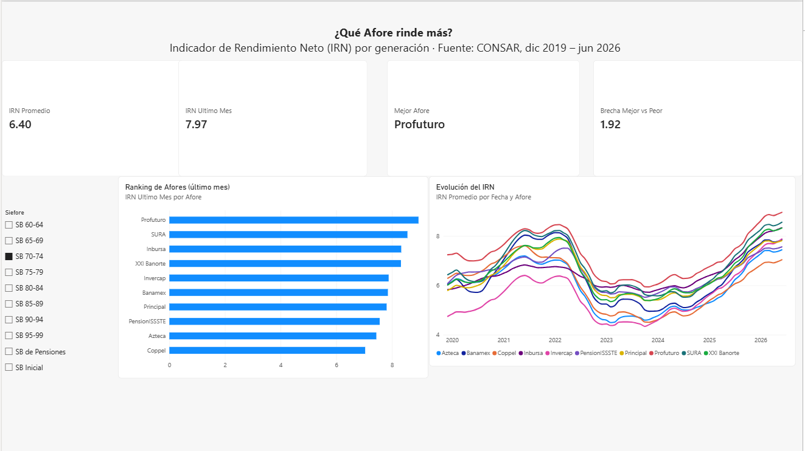

# Dashboard de rendimientos de las Afores (Power BI)

Dashboard interactivo que compara el **Indicador de Rendimiento Neto (IRN)** de las 10 Afores en México por generación (Siefore), con datos oficiales de la CONSAR de diciembre de 2019 a junio de 2026.



## Pregunta que responde

¿Qué Afore rinde más para mi generación, y qué tanto importa elegir bien?

## Hallazgos (junio de 2026)

- **La brecha entre la mejor y la peor Afore crece en las generaciones jóvenes:** alrededor de 2.1 puntos porcentuales en las Siefores 80-84 a 95-99, contra 1.15 en la SB 60-64.
- **Profuturo tiene el IRN más alto en 9 de las 10 Siefores.** La excepción es la SB de Pensiones, donde el primer lugar es Coppel.
- El IRN de varias Afores bajó entre 2022 y 2024 y se recuperó después. Como el indicador promedia varios años, los periodos malos de mercado se reflejan con retraso.

> Los rendimientos pasados no garantizan rendimientos futuros. El IRN ya descuenta comisiones.

## Proceso

1. **Obtención de datos:** series mensuales del IRN de las Siefores Generacionales en el sistema estadístico de la CONSAR (SISET). La exportación completa fallaba en el servidor, así que los datos se descargaron por año (8 archivos).
2. **Limpieza en Power Query**, con los archivos combinados desde una carpeta para que una sola "receta" se aplique a todos:
   - Eliminación de encabezados, notas al pie y filas vacías.
   - Columna condicional + relleno hacia abajo para asignar cada Afore a su Siefore.
   - *Unpivot* (anular dinamización) de los meses: de formato ancho a formato largo.
   - Corrección de los meses en español que no se reconocían como fecha (Ene, Abr, Ago, Dic).
   - Eliminación de filas con error y asignación de tipos de datos.
3. **Validación:** el conteo final (7,350 registros) y los indicadores se compararon contra un cálculo independiente.
4. **Medidas en DAX:**

```DAX
IRN Promedio = AVERAGE(Rendimientos[IRN])

IRN Ultimo Mes =
VAR UltimaFecha = MAX(Rendimientos[Fecha])
RETURN CALCULATE([IRN Promedio], Rendimientos[Fecha] = UltimaFecha)

Mejor Afore =
VAR UltimaFecha = MAX(Rendimientos[Fecha])
VAR Tabla = ADDCOLUMNS(VALUES(Rendimientos[Afore]),
    "@IRN", CALCULATE([IRN Promedio], Rendimientos[Fecha] = UltimaFecha))
RETURN MAXX(TOPN(1, Tabla, [@IRN], DESC), Rendimientos[Afore])

Brecha Mejor vs Peor =
VAR UltimaFecha = MAX(Rendimientos[Fecha])
VAR Tabla = ADDCOLUMNS(VALUES(Rendimientos[Afore]),
    "@IRN", CALCULATE([IRN Promedio], Rendimientos[Fecha] = UltimaFecha))
RETURN MAXX(Tabla, [@IRN]) - MINX(Tabla, [@IRN])
```

5. **Diseño:** segmentación por Siefore, ranking de Afores, evolución histórica y edición de interacciones para que las tarjetas resumen no se filtren con el ranking.

## Archivos

- `Dashboard_Afores.pbix`: el dashboard (se abre con Power BI Desktop, gratuito).
- `Rendimientos afore por mes/`: archivos CSV por año, tal como se descargaron de la CONSAR.

## Fuente

CONSAR, Sistema de Información Estadística: Indicador de Rendimiento Neto (IRN) de las Siefores Generacionales.

---
Edel Oswaldo Magno Juárez · Matemáticas, UNAM
